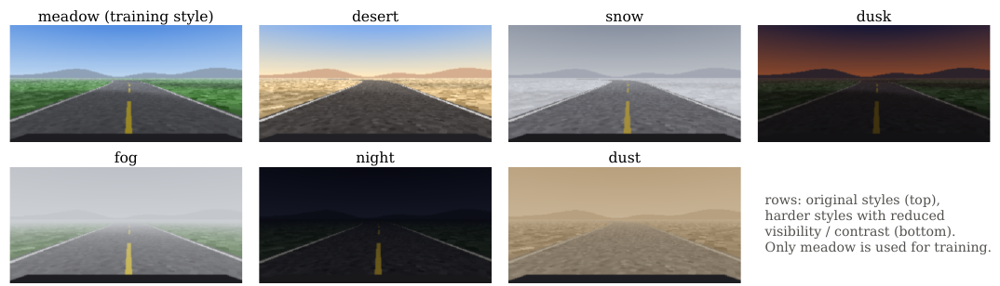
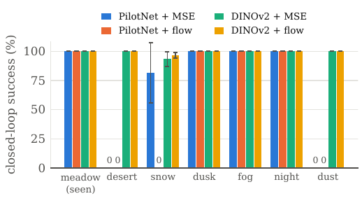
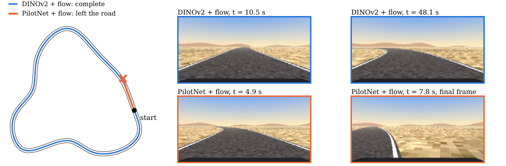
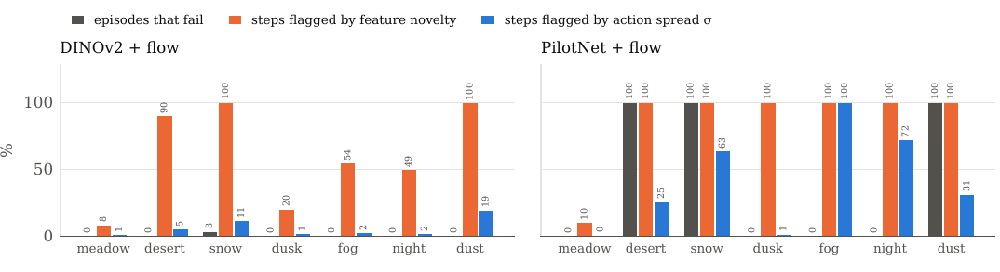
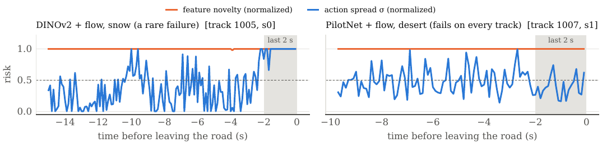

# DriveFM

End-to-end steering from a forward camera, trained by imitation and tested in closed loop under visual domain shift.

The project asks two things:

- Do frozen foundation-model features (DINOv2) keep a driving policy working on roads and visual conditions it never saw in training?
- Which uncertainty signals warn before the car leaves the road: signals that measure how unfamiliar the input is, or signals that measure how unsure the policy is about its steering?

Paper: *Detecting Shift Is Not Predicting Failure: Uncertainty Signals for End-to-End Driving under Visual Domain Shift* (R. R. R. Pydi, G. Kaur).



---

## Results

All numbers come from the full study run on one laptop (RTX 4050 6 GB, 20-thread CPU). Models are trained on meadow-style tracks only and tested on 20 unseen tracks per style. Every model is trained with 3 seeds, so each cell below is 60 laps. In total: over 4,500 closed-loop laps, about 2,300 km.

### Generalization to unseen styles

Closed-loop success rate (%), no speed gate.

| Model | meadow | desert | snow | dusk | fog | night | dust |
|---|---|---|---|---|---|---|---|
| PilotNet + MSE | 100 | 0 | 82 ± 26 | 100 | 100 | 100 | 0 |
| PilotNet + flow | 100 | 0 | 0 | 100 | 100 | 100 | 0 |
| DINOv2 + MSE | 100 | 100 | 93 ± 6 | 100 | 100 | 100 | 100 |
| DINOv2 + MSE, 8-step chunks | 100 | 100 | 92 ± 8 | 100 | 100 | 100 | 100 |
| DINOv2 + flow | 100 | 100 | 97 ± 2 | 100 | 100 | 100 | 100 |

The frozen DINOv2 encoder handles every unseen style. PilotNet fails exactly in the two styles that have no center line (desert, dust). All 11 DINOv2 failures happen in snow.





### Which signal predicts failure?

Each time step is labeled positive if the car leaves the road within the next 2 s. AUROC over all steps of all 420 laps per model; FA = share of steps with an alarm on laps that finished without failure.

| Model (failures) | Output uncertainty | Mahalanobis | kNN | Autoencoder |
|---|---|---|---|---|
| DINOv2 + flow (2) | **0.99** (FA 6%) | 0.79 (FA 61%) | 0.66 (FA 83%) | 0.57 (FA 86%) |
| DINOv2 + MSE (4) | **0.99** (FA 8%) | 0.81 (FA 61%) | 0.67 (FA 80%) | 0.57 (FA 86%) |
| DINOv2 + MSE, 8-step (5) | **0.99** (FA 6%) | 0.81 (FA 60%) | 0.70 (FA 76%) | 0.57 (FA 86%) |
| PilotNet + flow (180) | 0.54 (FA 44%) | 0.62 (FA 78%) | 0.60 (FA 85%) | 0.62 (FA 76%) |
| PilotNet + MSE (131) | – | 0.65 (FA 83%) | 0.56 (FA 93%) | 0.60 (FA 80%) |

Output uncertainty is the sample spread of the flow head, or MC dropout for the MSE heads. The three novelty detectors pick up every style change, including the ones the policy drives through without trouble, so they flag most of every safe lap. Output uncertainty raised an alarm before all 11 DINOv2 failures and stays quiet otherwise. On PilotNet it does not help: the policy is about as confident while drifting off the road as while driving correctly.





### Slowing down when uncertain

The speed gate lowers the target speed from 20 to 10 mph as risk rises. It did not change failures per km for any model or signal (PilotNet + flow in snow: 39.0 without a gate, 37.5–39.4 with one; every 95% interval for the change contains zero). The failures are steering errors, and they happen at 10 mph as well.

### Smoothness: flow head or action chunks?

| Model | Output | Steering jerk (×10⁻³) | Success |
|---|---|---|---|
| DINOv2 + MSE | 1 step | 11.4 | 98% |
| DINOv2 + MSE | 8-step chunk | 4.4 | 98% |
| DINOv2 + flow | 8-step chunk | 4.6 | 99% |

The smoother steering of the flow model comes from predicting 8-step chunks, not from the flow head.

### DAgger: adapting PilotNet + flow to desert

Success goes from 0% to 100% after one round with every query rule. The rules differ in how many expert labels they need.

| Query rule | Round 1 | Round 2 | Round 3 | Total labels |
|---|---|---|---|---|
| Label every frame | 6,567 | 7,477 | 6,809 | 20,853 |
| Ask when fused risk (novelty-dominated) > 0.9 | 6,567 | 7,475 | 6,733 | 20,775 |
| Ask when action spread > 0.5 | 6,499 | 1,022 | 404 | 7,925 |
| Ask when action spread > 0.9 | 4,938 | 374 | 375 | **5,687** |

Asking on the policy's own action spread needs 73% fewer labels for the same result.

---

## Features

- **Policies.**
  - Backbones: a PilotNet CNN trained from scratch, or any `timm` model, such as DINOv2, ResNet or ConvNeXt, frozen or partially fine-tuned.
  - Inputs: optional multi-frame context with a temporal Transformer.
  - Outputs: chunks of future steering commands.
  - Heads: MSE regression, a Mixture Density Network, or conditional flow matching with mode-seeking decoding.
- **Uncertainty.**
  - From the policy itself: flow-sample spread and MDN variance.
  - From several models: deep ensembles, and MC-dropout.
  - Feature-space novelty: a Mahalanobis distance on the policy embedding, fitted automatically after training.
- **Risk-gated control.** The car slows down when the policy is uncertain or the input is unfamiliar. Thresholds are calibrated automatically on validation data.
- **Simulators.**
  - **DriveLite** (included): lightweight, with procedurally generated tracks in seven visual styles.
  - **MetaDrive** (optional): procedurally generated road networks.
  - **Udacity**: legacy support.
- **Data.** Automatic expert demonstrations with DART noise injection, which records recovery behavior, plus DAgger, either classic or with uncertainty-gated expert queries.
- **Evaluation.**
  - Offline: steering error, smoothness, calibration, error detection, and domain-shift detection.
  - Closed loop on unseen roads: success rate, route completion, failures per km, lane error, steering jerk, and failure-prediction AUROC.
- **Experiment runner.** One script runs the whole study (data, training, closed-loop tests, DAgger, tables and figures), resuming where it stopped if interrupted.

---

## Simulators

| | **DriveLite** (default) | **MetaDrive** (optional) | Udacity (legacy) |
|---|---|---|---|
| Install | included (numpy, scipy, OpenCV) | `pip install metadrive-simulator`, Python ≤ 3.11 | 2017 Unity build |
| Hardware | any machine, no GPU needed | GPU / OpenGL; headless via `xvfb-run` | display needed |
| Speed with camera | ~55–60 steps/s on a laptop CPU | fast on a GPU | real time |
| Roads | unlimited procedural closed tracks | unlimited procedural maps: curves, ramps, roundabouts, intersections | 2 fixed tracks |
| Visual styles | meadow, desert, snow, dusk, fog, night, dust | one | 2 |
| Expert driver | pure pursuit | IDM, or MetaDrive's PPO expert | none |
| Data collection | automatic | automatic | manual |
| Closed-loop metrics | automatic | automatic, including crashes | manual |

All simulators share one interface (`drivefm/envs`) and write the same log format, so every model and script works with each of them.

**DriveLite evaluation setup.** Models train on meadow-style tracks with seeds 0–59 and are tested on unseen track seeds (1000+). Testing in the meadow style measures generalization to new road shapes; the other six styles measure generalization to new visual conditions.

---

## Installation

Requires Python 3.9+ (3.11 if you also want MetaDrive) and an NVIDIA GPU for DINOv2 models.

**Linux / WSL:**
```bash
bash setup/setup_linux.sh
```

**Windows** (PowerShell, from the project folder):
```powershell
powershell -ExecutionPolicy Bypass -File setup\setup_windows.ps1
```

The setup scripts:
- create `.venv`;
- install PyTorch with the CUDA build that matches your NVIDIA driver;
- install the requirements, and MetaDrive if your Python version supports it;
- benchmark the machine with `scripts/check_setup.py`;
- run the tests.

**Manual install:**
```bash
python -m venv .venv && source .venv/bin/activate          # Windows: .venv\Scripts\activate
pip install torch torchvision --index-url https://download.pytorch.org/whl/cu126   # cu126: driver >= 560, cu130: driver >= 580
pip install -r requirements.txt
python scripts/check_setup.py                                # GPU check, DINOv2 download, speed benchmark
pytest -q
```

Optional extras:
```bash
pip install -r requirements-metadrive.txt     # MetaDrive (Python <= 3.11)
pip install -r requirements-sim.txt           # Udacity simulator server
```

The first DINOv2 run downloads `vit_small_patch14_dinov2.lvd142m` (~90 MB) through `timm`.

---

## Quick start

On Windows, run these in Git Bash with `source .venv/Scripts/activate`.

```bash
source .venv/bin/activate

# end-to-end check of every stage at small scale (~30-60 min on a laptop GPU)
PROFILE=quick bash scripts/run_focused.sh

# full study (~20 h on an RTX 4050 laptop GPU; the two follow-up stages add ~5 h each)
PROFILE=laptop bash scripts/run_focused.sh
```

The main study compares four models (plus `dinov2_mse_chunk8`, an MSE model with 8-step chunks used as a control):

| | MSE head | flow-matching head |
|---|---|---|
| **PilotNet** (from scratch) | `pilotnet_mse` | `pilotnet_flow` |
| **DINOv2 ViT-S/14** (frozen) | `dinov2_mse` | `dinov2_flow` |

Each model is trained with 3 seeds and tested in closed loop on unseen tracks in every style. The study also tests each speed gate (none, action spread, novelty, both), seed ensembles, and DAgger adaptation.

**Running stages separately.** Use `STAGES` to run part of the study:
```bash
PROFILE=laptop STAGES="data train" bash scripts/run_focused.sh
PROFILE=laptop STAGES="closed_loop dagger tables" bash scripts/run_focused.sh
PROFILE=laptop STAGES="metadrive tables" bash scripts/run_focused.sh     # needs MetaDrive
PROFILE=laptop STAGES="followup tables" bash scripts/run_focused.sh      # follow-up experiments
PROFILE=laptop STAGES="followup2 tables" bash scripts/run_focused.sh     # harder styles, extra baselines, sigma-gated DAgger
```
Re-running a command skips work that is already finished.

**Follow-up experiments** (`followup` stage):
- Gated ensemble tests use speed-gate thresholds calibrated on the ensemble's own validation spread.
- `dinov2_mse_chunk8` (MSE head with 8-step action chunks) separates the effect of the flow head from the effect of chunking on smoothness.
- DAgger starts from `pilotnet_flow`, which fails in desert, and is scored without the speed gate; round 0 is the policy before any expert labels.
- The time limit scales with track length, so slow but safe laps count as timeouts, reported separately from failures.

**Second follow-up** (`followup2` stage):
- Three harder styles: fog, night and dust.
- DAgger that queries the expert on the flow head's action spread only.
- `scripts/extra_signals.py`: kNN feature distance, MC dropout and an autoencoder (SelfOracle-style), computed on every logged test lap by replaying it exactly in the simulator.

**Watching the car drive.** `scripts/watch.py` opens a live window with each model's camera view, steering, uncertainty meters and a map of the track, and can save the run as an MP4:
```bash
# one model on an unseen desert track
python scripts/watch.py --ckpt runs/focused/dinov2_flow_s0/best.pt --style 1 --track 1014
# two models side by side, saved to a video
python scripts/watch.py --ckpt runs/focused/dinov2_flow_s0/best.pt runs/focused/pilotnet_flow_s0/best.pt \
    --style 1 --track 1014 --save videos/desert_1014.mp4
```
Styles: 0 meadow (training style), 1 desert, 2 snow, 3 dusk, 4 fog, 5 night, 6 dust. Tracks 1000–1019 are the unseen test tracks. Press SPACE to pause and `q` to quit.

`scripts/paper_figures.py` drives two trained models live on one unseen track and saves the paper's driving figures (`fig_drive`, `fig_styles`), the lap results and every camera frame to `results/focused/paper_figs`.

**Profiles.**
- `quick`: small end-to-end check.
- `laptop`: the full study, tuned for a 6 GB GPU and a 16–20-thread CPU.
- `cpu`: PilotNet models only, for machines without a GPU.

**Overriding settings.** Environment variables override profile defaults, for example `JOBS=3 WORKERS=6`, `SEEDS="0 1"` or `EPOCHS_FLOW=50`.

### Outputs

`results/focused/`:
- `REPORT.md`: all result tables (closed-loop generalization, domain-shift detection, failure prediction, speed-gate effect, DAgger).
- `fig_generalisation.png`, `fig_failure_prediction.png`
- `*.tex`: LaTeX versions of the tables.
- `closed_loop/`: per-episode summaries and telemetry.
- `logs/`: one log per job.

Trained models are saved in `runs/focused/<model>_s<seed>/`:
- `best.pt`: the checkpoint;
- `metrics.json`: offline metrics;
- `log.csv`: training curves;
- plots of the policy's steering on the test tracks.

---

## Usage

The study runner calls the scripts below; each can also be used directly.

### 1. Collect expert data
The expert's executed steering gets correlated noise, while every frame is labeled with the clean expert action, so the data includes recoveries from drift.
```bash
python scripts/collect.py --env drivelite --out data/dl_train      --seeds 0-59      --style 0 --noise 0.15
python scripts/collect.py --env drivelite --out data/dl_test_shape --seeds 1000-1009 --style 0 --noise 0
python scripts/collect.py --env drivelite --out data/dl_test_snow  --seeds 1000-1009 --style 2 --noise 0
python scripts/collect.py --env metadrive --out data/md_train      --seeds 0-99 --map_blocks 4 --noise 0.15
```
Each folder contains `IMG/`, `driving_log.csv` and `meta.json`, in Udacity format.

### 2. Train
Combine a model config with a simulator preset; override any key with `--set`.
```bash
python scripts/train.py --config configs/focused/dinov2_flow.yaml configs/sims/drivelite.yaml --seed 0 \
    --out runs/dinov2_flow_s0 --set train.epochs=30
```
Training uses:
- bf16 mixed precision;
- EMA weights and a cosine learning-rate schedule;
- a time-block validation split with purging, so near-duplicate frames don't leak between training and validation.

After training, the feature-novelty detector is fitted and its validation quantiles are stored in `best.pt`.

### 3. Offline evaluation
```bash
python scripts/evaluate.py --ckpt runs/dinov2_flow_s0/best.pt --logs data/dl_test_snow/driving_log.csv
python scripts/evaluate.py --ckpt runs/dinov2_flow_s{0,1,2}/best.pt --logs data/dl_test_snow/driving_log.csv   # ensemble
```

### 4. Closed-loop evaluation
```bash
python scripts/closed_loop_eval.py --env drivelite --style 2 --seeds 1000-1019 \
    --ckpt runs/dinov2_flow_s0/best.pt --tag snow --video 2
```

**Speed gate.** The risk score is 0 at or below the validation median and 1 at or above the validation 95th percentile. It is computed for both action spread and novelty, and their maximum is used by default. Risk maps the target speed between `--max_speed` and `--min_speed`.
- `--unc_source sigma|ood|max` picks the signal.
- `--no_gate` drives at constant speed.

**Reported metrics:**
- success rate and route completion;
- failures per km and mean lane error (CTE);
- steering jerk;
- failure-prediction AUROC per signal;
- alarm recall and false-alarm rate.

Aggregate several runs into a table:
```bash
python scripts/aggregate_closed_loop.py --dir "results/closed_loop/*" --out results/closed_loop.tex
```

### 5. DAgger
```bash
python scripts/dagger.py --env drivelite --style 2 --init_ckpt runs/dinov2_flow_s0/best.pt \
    --base_logs data/dl_train/driving_log.csv --iters 3 --seeds_per_iter 10 \
    --query uncertainty --risk_tau 0.5 --eval_seeds 1000-1019 --out runs/dagger_snow
```
- `--query all` labels every visited frame (classic DAgger).
- `--query uncertainty` asks the expert only where risk ≥ `--risk_tau`.

`dagger_history.json` records the labels used and the closed-loop results for each round.

### Udacity simulator
1. Record manually in the simulator.
2. Train with `configs/sims/udacity.yaml`.
3. Drive with `scripts/drive.py`, pressing Enter at each intervention.
4. Compute the autonomy metric with `scripts/closed_loop_report.py`.

---

## Configuration

- **`configs/focused/*.yaml`**: the models of the study.
- **`configs/*.yaml`**: additional models (ResNet-18, DINOv2 + MDN, partially fine-tuned DINOv2).
- **`configs/sims/*.yaml`**: data paths and cropping for each simulator.
- **`drivefm/config.py`**: every option, with defaults.

**Common options:**
- `model.backbone` (`pilotnet` or `timm:<name>`)
- `model.head` (`mse`, `mdn`, `flow`)
- `model.freeze_backbone`
- `data.context_frames`
- `data.chunk`
- `model.flow_decode`
- `train.epochs`
- `train.batch_size`

**Training tips.**
- Flow-matching heads converge more slowly than MSE heads; use about 30 epochs or more.
- Check `best_epoch` in `metrics.json`. If it is close to the final epoch, train longer.

**Making DriveLite easier or harder:**
- the `--max_speed` limit;
- curve sharpness (`min_radius` in `make_track`);
- steering-actuator lag (`steer_rate`);
- `randomize_lighting`;
- the number of training tracks.

In MetaDrive, use `--map_blocks` and `--traffic`.

---

## Repository structure

```
drivefm/
  envs/drivelite.py      procedural tracks, camera renderer, bicycle model, pure-pursuit expert
  envs/metadrive_env.py  MetaDrive wrapper (RGB camera, IDM expert)
  models/                backbones, heads (MSE / MDN / flow matching), policy, ensembles, novelty
  data.py augment.py     log loading, time-block splits, augmentation
  agent.py               closed-loop agent: frame buffer, chunk ensembling, risk-gated speed
  evaluation.py          offline metrics and plots
  recorder.py            writes simulator episodes as training logs
  replay.py              exact replay of a logged lap (recovers every camera frame)
scripts/
  run_focused.sh         full study runner
  collect.py train.py evaluate.py closed_loop_eval.py dagger.py
  aggregate.py aggregate_closed_loop.py summarize_dagger.py focused_report.py
  extra_signals.py       kNN / MC-dropout / autoencoder failure-prediction baselines
  watch.py paper_figures.py   live viewer and paper figures
  check_setup.py         machine check and benchmark
  run_drivelite_benchmark.sh run_metadrive_benchmark.sh   extended experiment grids
  drive.py closed_loop_report.py                          Udacity tools
configs/                 model configs, focused study configs, simulator presets
setup/                   Linux and Windows setup scripts
tests/                   unit and end-to-end tests
```

## Tests

```bash
pytest -q                                                   # models, data, training, DriveLite, full loop, DAgger
DRIVEFM_TEST_METADRIVE=1 pytest -q tests/test_sims.py -k metadrive
```

## Troubleshooting

| problem | fix |
|---|---|
| `CUDA not available` | update the NVIDIA driver, or reinstall PyTorch from the `cu126` index |
| out of GPU memory | `JOBS=3`, or add `train.batch_size=32` to the training overrides |
| machine overheats or throttles | `JOBS=3 WORKERS=6` |
| MetaDrive rendering errors | run headless with `xvfb-run -a`, or skip the `metadrive` stage |
| interrupted run | run the same command again; finished steps are skipped |

## References

Methods implemented in this project:
- PilotNet (Bojarski et al., 2016)
- DAgger (Ross et al., 2011)
- DART (Laskey et al., 2017)
- Mixture Density Networks (Bishop, 1994)
- Flow Matching (Lipman et al., 2023) and Rectified Flow (Liu et al., 2023)
- Action chunking (Zhao et al., 2023)
- DINOv2 (Oquab et al., 2023)
- Deep ensembles (Lakshminarayanan et al., 2017)
- MC-dropout (Gal & Ghahramani, 2016)
- Mahalanobis feature novelty (Lee et al., 2018)
- MetaDrive (Li et al., 2022)
- kNN out-of-distribution detection (Sun et al., 2022)
- SelfOracle autoencoder misbehavior prediction (Stocco et al., 2020)
