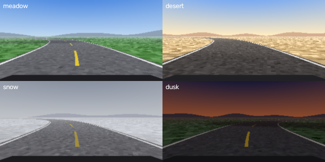

# DriveFM: foundation-model features, generative action chunks and calibrated uncertainty for end-to-end driving

This project extends a classic **PilotNet behavioural-cloning** project (Keras, Udacity simulator, Track 1 → Track 2) into a controlled 2026-style study, with automatic closed-loop evaluation on **unlimited unseen roads**.

> **Research question.** Can frozen vision foundation-model features, generative (multi-modal) action heads and calibrated uncertainty close the **generalisation gap to unseen roads and unseen visual conditions** in end-to-end behavioural cloning? Which kind of uncertainty actually **predicts the policy's own failures**: action spread (aleatoric) or feature novelty (epistemic)? Can it make closed-loop driving safer and decide **when to ask an expert for labels** (DAgger)?

---

## Simulators: pick one (all share one API and one data format)

| | **DriveLite** (included, default) | **MetaDrive** (recommended for the paper) | Udacity (legacy) |
|---|---|---|---|
| Install | nothing extra (numpy + scipy + OpenCV) | `pip install metadrive-simulator` (Python ≤ 3.11) | download a 2017 Unity build |
| Runs on | any laptop, any Python ≥ 3.9, no GPU | Linux / Windows with GPU or OpenGL; headless via `xvfb-run` | Win / Mac / Linux, display needed |
| Speed with camera | ~55–60 FPS on a laptop CPU | fast on a GPU (~1 FPS with CPU software rendering) | real time only |
| Roads | unlimited procedural closed tracks (seeded) | unlimited procedural maps: curves, ramps, roundabouts, intersections | 2 fixed tracks |
| Visual domains | 4 styles: meadow, desert, snow, dusk | one look; traffic optional | 2 |
| Expert | pure pursuit, built in | IDM (or MetaDrive's PPO expert) | none (you drive) |
| Data collection | automatic, DART noise injection | automatic, DART noise injection | manual |
| Closed-loop metrics | automatic: success, completion, CTE, failures/km, fail-AUROC | automatic: same + crashes | manual ENTER = intervention |
| DAgger | yes | yes | no |

**Recommended workflow.**
1. Iterate on **DriveLite**: it runs everywhere, a full benchmark fits on one GPU in about a day, and its 2×2 generalisation matrix (shape × style) is clean.
2. Report the main table on **MetaDrive** as well, because reviewers know it (Li et al., TPAMI 2022).
3. Udacity remains supported for continuity with the original project.

### DriveLite in one picture


Train on style 0 (meadow) tracks with seeds 0–59. Test on **unseen track seeds 1000+** in the same style ("shape" generalisation), and on unseen seeds in **unseen styles** (snow, dusk) for visual generalisation.

```bash
python scripts/collect.py --env drivelite --out data/dl_train --seeds 0-59 --style 0 --noise 0.15
python scripts/train.py   --config configs/dinov2_flow.yaml configs/sims/drivelite.yaml --seed 0 --out runs/dl_dinov2_flow_s0 --set name=dl_dinov2_flow
python scripts/closed_loop_eval.py --env drivelite --style 2 --seeds 1000-1019 --ckpt runs/dl_dinov2_flow_s0/best.pt --tag snow --video 2
```

**Sanity check run during development** (CPU, tiny data, PilotNet baseline: 6 training tracks, 6 epochs; these are *not* paper results):

| test | success | route completion | mean \|CTE\| | offline MAE |
|---|---|---|---|---|
| unseen tracks, same style | 3/3 | 100 % | 0.05 m | 0.009 |
| unseen tracks, **snow** | 0/3 | 29 % | 0.96 m | 0.049 |

The baseline handles new road shapes but collapses under a new visual style, which is exactly the gap the proposed methods target. Offline error grew only 5× while closed-loop success fell from 100 % to 0 %. This is the known offline/closed-loop mismatch (Codevilla et al., ECCV 2018), and it is why closed-loop numbers are the main results.

**A second sanity check: which uncertainty sees the domain shift?** A PilotNet-backbone flow policy (8-step chunks, 3 frames of context) was trained on the same 6 tracks for 15 epochs:

| signal | errors in distribution (AUROC) | detects snow vs. familiar frames (shift AUROC) | mean on familiar val / snow |
|---|---|---|---|
| flow action spread σ (aleatoric) | **0.86–0.91** | 0.37 (blind to the shift) | 0.029 / 0.027 |
| feature novelty, Mahalanobis (epistemic) | – | **1.00** | 0.45 / 14.7 |

In closed loop with the combined risk gate (`--unc_source max`):
- **Familiar style:** the car still completes 4/4 tracks, with an alarm on about 10 % of steps.
- **Snow:** risk is maximal from the first frame, the car slows to the minimum speed, and every failure is preceded by an alarm. Detection works, but slowing down does not fix wrong steering.

The fix has to come from the representation (H1) or from adaptation (H4).

**A third sanity check: novelty-gated DAgger in snow.** Starting from the flow policy above (0/4 on snow), `dagger.py --style 2 --query uncertainty` ran 3 rounds of 3 snow tracks each:

| round | expert labels (cumulative) | success on 4 unseen snow tracks |
|---|---|---|
| 0 (BC only) | 0 | 0/4 |
| 1 | 1,698 | **4/4** |
| 2 | 3,448 | 4/4 |
| 3 | 5,171 | 4/4 |

Adaptation is fast. The honest caveat: with `--risk_tau 0.5`, the gate still requested about 98 % of frames, because risk stayed high after adaptation. That happens because the novelty thresholds come from validation data that is mostly the original style. The real label-efficiency study (H4) therefore needs a sweep over `--risk_tau` and/or recalibration of the thresholds after each round; this is an open research knob, not a solved feature.

These are tiny CPU runs with 1 seed, meant to show the pipeline produces meaningful signals. They are not results to publish.

---

## What changes compared with the 2020 project

| | 2020 project (baseline) | This repo |
|---|---|---|
| Framework | Keras / TF | PyTorch 2, AMP, EMA weights, cosine LR |
| Simulator / data | Udacity, manual driving, 2 tracks | **DriveLite / MetaDrive**: procedural unseen roads, automatic expert with **DART** noise injection, **DAgger** |
| Backbone | PilotNet trained from scratch | PilotNet **or** any `timm` model: DINOv2, ResNet, ConvNeXt, SigLIP… frozen, partially or fully fine-tuned |
| Input | 1 frame | K frames + temporal Transformer |
| Feature pooling | flatten | position-preserving spatial bottleneck (`proj_flatten`); attention pooling as an ablation |
| Output | 1 steering value | **action chunk** of H future steering values |
| Head | MSE regression | MSE / **Mixture Density Network** / **Conditional Flow Matching** with mode-seeking decoding |
| Uncertainty | none | flow-sample spread, MDN variance, **deep ensembles**, MC-dropout, and **feature-space novelty** (Mahalanobis on the policy embedding, fitted automatically after training) |
| Validation split | random 80/20 (leaks near-duplicate frames) | **time-block split + purging**; random split kept as an ablation |
| Control | constant-throttle PI | **risk-gated speed** (σ and/or novelty, thresholds auto-calibrated on validation) + temporal ensembling of chunks |
| Evaluation | val loss + "it drives" | offline: MAE, jitter, NLL, coverage, AUROC, E-AURC. Closed loop on unseen roads: **success rate, completion, failures/km, CTE, jerk, failure-prediction AUROC** |

## Hypotheses the experiments test

- **H1 (representation).** Frozen DINOv2 features generalise to unseen *styles* far better than PilotNet or an ImageNet CNN. They may matter less for unseen *shapes*.
- **H2 (multi-modality).** Flow and MDN action chunks avoid mode-averaging and drive more smoothly than MSE: lower jerk and fewer failures.
- **H3 (uncertainty).** Aleatoric σ flags hard in-distribution states, while feature novelty flags domain shift; their combination gives the best failure prediction (fail-AUROC, alarm recall at a low false-alarm rate), and risk-gated speed reduces failures/km.
- **H4 (label efficiency and adaptation).** Uncertainty-gated DAgger, especially novelty-gated in a new visual domain, reaches classic-DAgger performance with a fraction of the expert labels.
- **H5 (methodology).** A random per-frame split overestimates performance; the val–test gap shows it.

Any of these can come out negative. A negative result reported with 3 seeds and confidence intervals is still a valid finding.

---

## Install

```bash
python -m venv .venv && source .venv/bin/activate      # Windows: .venv\Scripts\activate
pip install torch torchvision --index-url https://download.pytorch.org/whl/cu121   # pick your CUDA version
pip install -r requirements.txt                         # DriveLite needs nothing else
pytest -q                                               # ~2 min on CPU: trains, drives and runs DAgger end to end

# optional: MetaDrive (use a Python 3.11 environment)
pip install -r requirements-metadrive.txt
DRIVEFM_TEST_METADRIVE=1 pytest -q tests/test_sims.py -k metadrive
# optional: Udacity simulator server
pip install -r requirements-sim.txt
```

The first DINOv2 run downloads `vit_small_patch14_dinov2.lvd142m` (~90 MB) through `timm`.

## One-command benchmarks

```bash
bash scripts/run_drivelite_benchmark.sh     # data -> 6 models x 3 seeds -> ablations -> closed loop -> ensembles -> DAgger -> LaTeX tables
bash scripts/run_metadrive_benchmark.sh     # same on MetaDrive maps, plus an unseen-maps-with-traffic setting
bash scripts/run_udacity_benchmark.sh data/track1/driving_log.csv data/track2_eval/driving_log.csv   # legacy
```

Override the scale with environment variables, e.g. `SEEDS="0" TRAIN_TRACKS=0-19 MODELS="pilotnet_mse dinov2_flow" bash scripts/run_drivelite_benchmark.sh` for a quick pass.

## Step by step

**1. Collect expert data.** DART (Laskey et al., CoRL 2017): the car executes expert steering plus correlated noise, and every frame is labelled with the *clean* expert action, so the data contains recoveries.
```bash
python scripts/collect.py --env drivelite --out data/dl_train      --seeds 0-59     --style 0 --noise 0.15
python scripts/collect.py --env drivelite --out data/dl_test_shape --seeds 1000-1009 --style 0 --noise 0
python scripts/collect.py --env drivelite --out data/dl_test_snow  --seeds 1000-1009 --style 2 --noise 0
python scripts/collect.py --env metadrive --out data/md_train      --seeds 0-99 --map_blocks 4 --noise 0.15
```
Each output folder is in Udacity format (`IMG/` + `driving_log.csv`, plus `meta.json`), so the same loader handles every simulator.

**2. Train.** Stack a model config with a simulator preset; any key can be overridden with `--set`.
```bash
python scripts/train.py --config configs/pilotnet_mse.yaml configs/sims/drivelite.yaml --seed 0 --set name=dl_pilotnet_mse
python scripts/train.py --config configs/dinov2_flow.yaml  configs/sims/drivelite.yaml --seed 0 --set name=dl_dinov2_flow data.chunk=16
```

**3. Offline evaluation** (deep ensemble = pass several checkpoints):
```bash
python scripts/evaluate.py --ckpt runs/dl_dinov2_flow_s{0,1,2}/best.pt --logs data/dl_test_snow/driving_log.csv --out runs/ens_flow
```

**4. Closed-loop evaluation on unseen roads** (automatic, with optional mp4 videos):
```bash
python scripts/closed_loop_eval.py --env drivelite --style 3 --seeds 1000-1019 --ckpt runs/dl_dinov2_flow_s0/best.pt --tag dusk --video 3
python scripts/closed_loop_eval.py ... --no_gate        # ablation: constant speed
python scripts/aggregate_closed_loop.py --dir "results/closed_loop/*" --out results/closed_loop.tex
```
The risk score is 0 at or below the validation median and 1 at or above the validation 95th percentile, for σ and for novelty; it is the max of the two by default. It sets the target speed between `--max_speed` and `--min_speed`. Ablate it with `--unc_source sigma|ood|max` or `--no_gate`. Summaries report:
- fail-AUROC for σ, novelty and the combined risk;
- alarm recall: the share of failures preceded by risk ≥ 0.5;
- the false-alarm rate on successful episodes.

**5. DAgger** (Ross et al., AISTATS 2011): classic, or with uncertainty-gated expert queries.
```bash
python scripts/dagger.py --env drivelite --init_ckpt runs/dl_dinov2_flow_s0/best.pt --base_logs data/dl_train/driving_log.csv \
    --iters 3 --seeds_per_iter 10 --query uncertainty --eval_seeds 1000-1019 --out runs/dl_dagger_uncertainty
```
`dagger_history.json` records labels used vs. closed-loop success per round, which gives the label-efficiency figure. `--query uncertainty` asks the expert only where risk ≥ `--risk_tau`. Run it in a *new* style (e.g. `--style 2 --eval_seeds ...`) to test novelty-gated adaptation to a new domain.

**Udacity (legacy).** Record manually, train with `configs/sims/udacity.yaml`, and drive with `scripts/drive.py`, pressing ENTER at each intervention; `scripts/closed_loop_report.py` then computes autonomy %.

## Difficulty knobs (if a setting is too easy or too hard)

- **DriveLite** (`drivefm/envs/drivelite.py`):
  - `max_speed` in `closed_loop_eval.py`;
  - `min_radius` / radius range in `make_track` (sharper curves);
  - `steer_rate` (actuator lag);
  - `randomize_lighting`;
  - training on fewer tracks.
- **MetaDrive:** `--map_blocks` (longer, more complex maps) and `--traffic` (crashes count as failures).

## Development notes

- **Flow heads need more optimisation steps than MSE.** On the synthetic test set, flow with 8-step chunks matched MSE accuracy only after about 30 epochs. Keep `epochs ≥ 30` and a generous `patience`.
- **Attention pooling learns road position slowly**, which is why `proj_flatten` is the default (ablation: `abl_attnpool`).
- **Decoding matters.** A single KDE-mode sample jitters; `mode_mean`, a mean-shift step around the densest mode, keeps multi-modality without the jitter (ablation: `abl_meandec`).
- **MetaDrive's IDM expert** fails on a few maps (e.g. seed 100). `collect.py` drops the last 2 s before any failure, and logs expert failures in `meta.json`.
- **MetaDrive camera rendering is memory hungry.** It used about 4.5 GB RAM with CPU software rendering (stable, no leak), and much less on a GPU. On a machine with 8 GB or less, don't run collection at the same time as training.
- **Feature novelty is fitted after training.** `train.py` fits it on un-augmented training frames, stores its validation quantiles in `best.pt`, and reports `shift_auroc_ood` / `shift_auroc_sigma` for every test set in `metrics.json`.

## Repository layout

```
drivefm/
  envs/drivelite.py    procedural tracks, camera renderer, bicycle model, pure-pursuit expert
  envs/metadrive_env.py  MetaDrive wrapper (RGB camera, IDM expert, sign conventions)
  recorder.py          writes any simulator to Udacity-format logs
  config.py  data.py  augment.py  evaluation.py  agent.py  utils.py
  models/backbones.py  heads.py (MSE / MDN / flow matching)  policy.py (pooling, temporal, ensembles)
scripts/
  collect.py  train.py  evaluate.py  closed_loop_eval.py  dagger.py
  aggregate.py  aggregate_closed_loop.py
  run_drivelite_benchmark.sh  run_metadrive_benchmark.sh  run_udacity_benchmark.sh
  drive.py  closed_loop_report.py  make_synthetic_data.py      (Udacity tooling)
configs/  model configs  +  sims/{drivelite,metadrive,udacity}.yaml presets
tests/    test_smoke.py (models, data, training)   test_sims.py (simulators, full loop, DAgger)
```

## Suggested paper outline

1. **Introduction:**
   - behavioural cloning generalises poorly to unseen roads and conditions, and offline metrics hide it;
   - recent robot-learning advances (foundation features, flow/diffusion policies, action chunking, uncertainty-aware DAgger) have not been compared in a controlled, low-cost driving setting.
2. **Related work:** PilotNet (Bojarski et al. 2016); conditional imitation and offline-evaluation pitfalls (Codevilla et al. 2018, 2019); DAgger (Ross et al. 2011); DART (Laskey et al. 2017); SafeDAgger (Zhang & Cho 2017); EnsembleDAgger (Menda et al. 2019); MDNs (Bishop 1994); Diffusion Policy (Chi et al. 2023); Flow Matching / Rectified Flow (Lipman et al. 2023; Liu et al. 2023); action chunking (Zhao et al. 2023); π0 (Black et al. 2024); DINOv2 (Oquab et al. 2023); deep ensembles (Lakshminarayanan et al. 2017); MC-dropout (Gal & Ghahramani 2016); selective prediction (Geifman & El-Yaniv 2017); MetaDrive (Li et al. 2022).
3. **Method:** policy architecture, flow-matching objective, mode-seeking decoding, uncertainty-gated control and uncertainty-gated DAgger.
4. **Benchmark and protocol:** DriveLite shape × style matrix, MetaDrive unseen maps, metrics, seeds.
5. **Results:** main closed-loop table, offline-vs-closed-loop correlation, ablations, fail-AUROC and risk-coverage curves, DAgger label-efficiency curve, videos.
6. **Limitations:** simulation only; DriveLite's renderer is simple, so MetaDrive results matter for credibility; steering only, with PI speed control.

Venue realism: an honest, well-ablated version fits a robot-learning or intelligent-vehicles workshop, or IEEE IV / ITSC. Post it to arXiv once real results exist. Releasing DriveLite with the paper is a small extra contribution.

## What has been verified, and what has not

**Verified in development:**
- **Test suite:** 16 tests pass, plus 1 MetaDrive test that is opt-in.
- **Small CPU sanity experiments on DriveLite:** baseline and flow policies (closed loop), the novelty detector, and novelty-gated DAgger in snow.
- **DriveLite:** the expert completes laps in all 4 styles, steering-sign conventions are checked, and collect → train → closed-loop eval (with video) → DAgger runs end to end.
- **MetaDrive 0.4.3 (Python 3.11, headless via Xvfb software rendering):** camera observations, IDM expert, collect → train → closed-loop eval all ran.
- **Udacity:** the `drive.py` server was checked against a scripted client speaking the simulator protocol.

**Not verified in development:**
- pretrained DINOv2 weights (they download on your machine);
- MetaDrive on a GPU;
- the real Udacity simulator;
- any full-scale training run.

**All numbers in a paper must come from your own runs.**
